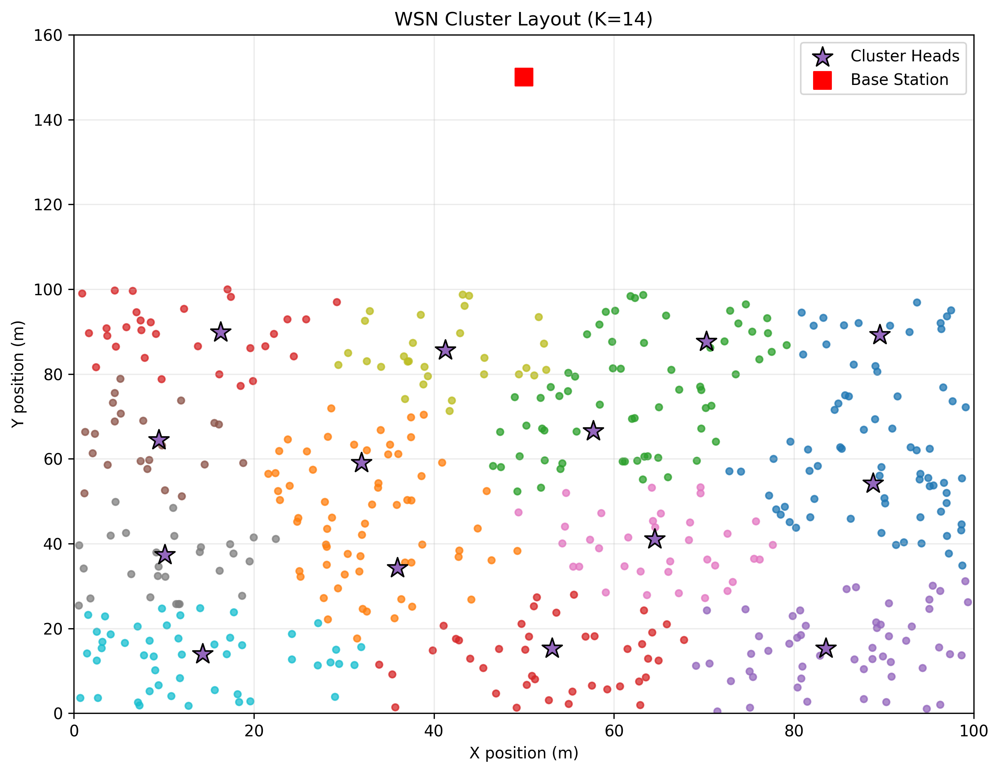
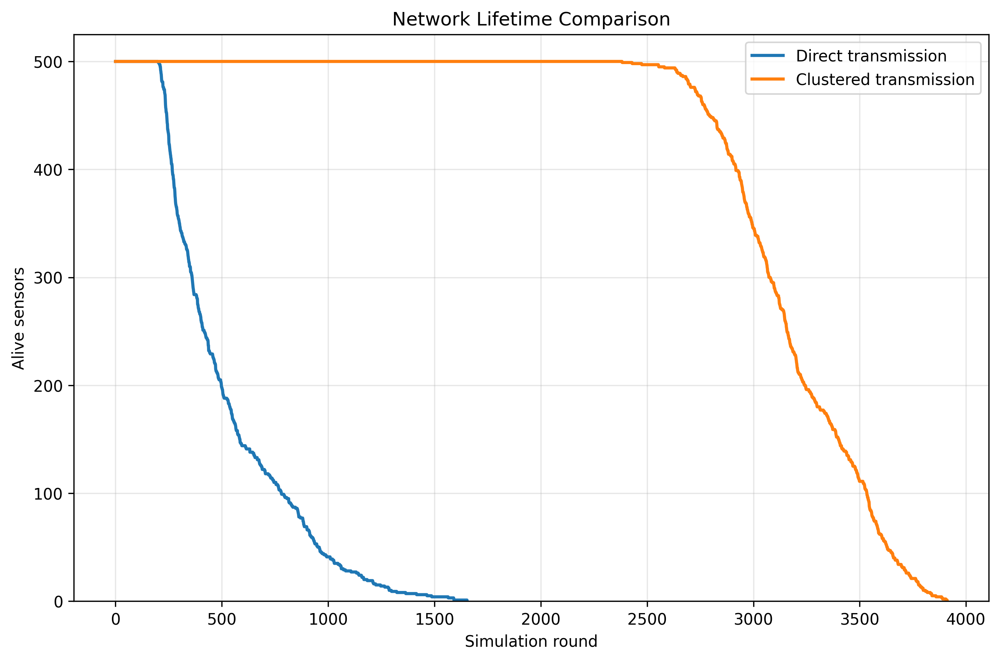
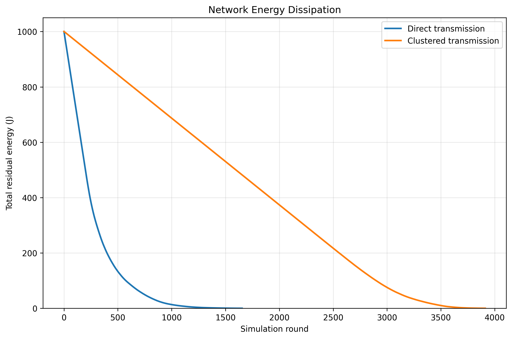
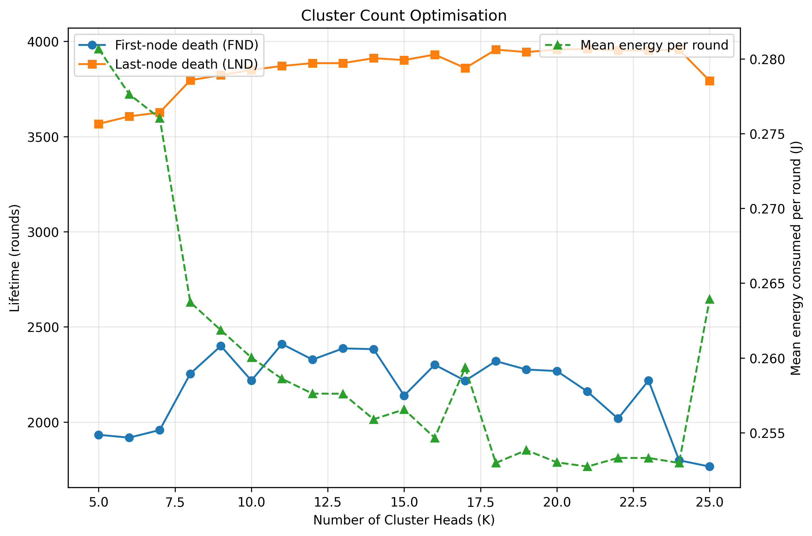
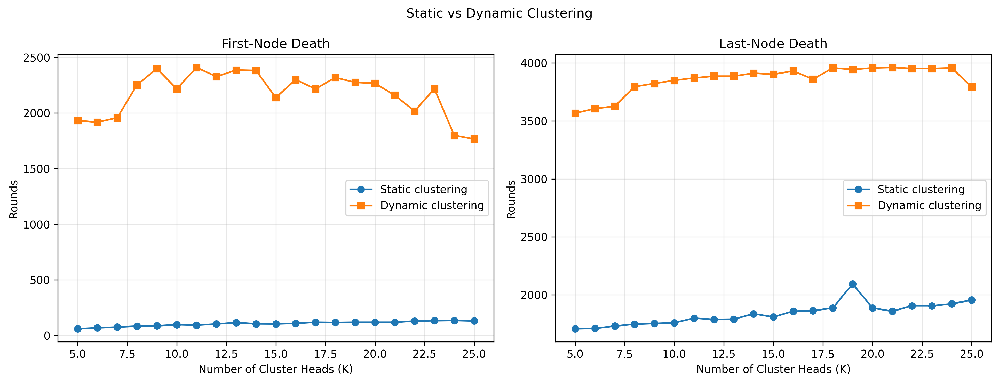

# Wireless Sensor Network Clustering Simulation

A Python-based simulation of energy-efficient communication in a Wireless Sensor Network (WSN) containing 500 battery-powered sensor nodes. The project compares direct sensor-to-base-station transmission with cluster-based communication and evaluates how spatial clustering, cluster-head selection, and cluster-head rotation influence energy consumption and network lifetime.

The sensor records used by the project are based on a dataset available on the internet. The repository includes the raw and preprocessed data files required to reproduce the simulation locally.

## Objectives

- Model communication energy consumption in a wireless sensor network.
- Compare direct transmission with clustered transmission.
- Use K-means to create spatial sensor groups.
- Select cluster heads using communication-cost and energy-aware heuristics.
- Evaluate static and dynamic cluster-head strategies.
- Identify a suitable number of clusters using simulated network lifetime and energy metrics.
- Generate visualisations for network layout, energy dissipation, lifetime, and cluster-count analysis.

## Key Features

- **Sensor deployment:** Loads and validates 500 sensor records containing position, temperature, and initial energy information.
- **K-means clustering:** Groups sensor nodes spatially using scikit-learn's K-means implementation.
- **Energy-aware cluster-head selection:** Selects one cluster head per K-means group using estimated communication energy, cluster-head burden, rotation history, and residual energy as selection criteria.
- **Direct communication baseline:** Simulates every live sensor transmitting one packet directly to the base station.
- **Clustered communication:** Simulates member-to-cluster-head transmission, cluster-head reception, data aggregation, and cluster-head-to-base-station transmission.
- **Static and dynamic cluster heads:** Supports fixed cluster-head assignments and dynamic cluster-head selection within the original deployment clusters.
- **Energy modelling:** Tracks transmission, reception, aggregation, residual battery energy, and sensor death.
- **Network lifetime evaluation:** Records the first-node death (FND), last-node death (LND), number of alive sensors, and residual network energy over simulation rounds.
- **Cluster-count optimisation:** Evaluates candidate values of `K` from 5 through 25 using FND, LND, and mean energy consumption per round.
- **Visualisation:** Generates five Matplotlib figures and stores them in the `results/` directory.

## System Configuration

The default simulation parameters are defined in [`src/config.py`](src/config.py).

| Parameter | Value |
|---|---:|
| Number of sensors | 500 |
| Deployment area | 100 m × 100 m |
| Base station | (50 m, 150 m) |
| Initial sensor energy | 1.90–2.10 J |
| Packet size | 4,000 bits |
| Simulation limit | 15,000 rounds |
| Candidate cluster count | 5–25 |
| Default cluster count | 25 |
| Random seed | 42 |
| Electronics energy, `E_ELEC` | 50 nJ/bit |
| Amplifier energy, `E_AMP` | 100 pJ/bit/m² |
| Data aggregation energy, `E_DA` | 5 nJ/bit |

The base station is positioned above the 100 m × 100 m deployment area at coordinates `(50, 150)`.

## Methodology

### 1. Direct Transmission

In the direct-transmission baseline, each live sensor sends one 4,000-bit packet directly to the base station during every simulation round. The transmission cost is calculated from the Euclidean distance between the sensor and the base station.

### 2. K-means Spatial Clustering

For clustered communication, the positions of live sensors are passed to K-means. The selected value of `K` determines the number of spatial groups and candidate cluster heads. K-means uses a fixed random state to make the spatial grouping reproducible.

### 3. Cluster-head Selection

One cluster head is selected for each K-means group. The implementation estimates the communication cost of possible candidates, including member transmissions, reception, aggregation, and the cluster-head's transmission to the base station. Battery burden and previous cluster-head usage are used to resolve selection priorities and support role rotation.

### 4. Clustered Communication

During a clustered round:

1. Each live non-head member transmits its packet to its cluster head.
2. The cluster head consumes energy to receive member packets.
3. The cluster head performs data aggregation, including its own reading.
4. The cluster head transmits the aggregated packet to the base station.

If a fixed cluster head dies in static mode, surviving members of that cluster fall back to direct transmission to the base station. In dynamic mode, an alive member is selected as the cluster head for each surviving deployment cluster on every round.

### 5. Radio Energy Model

The simulation uses the following first-order radio model:

- **Transmission:** `E_TX = L × (E_ELEC + E_AMP × d²)`
- **Reception:** `E_RX = L × E_ELEC`
- **Aggregation:** `E_DA_total = L × E_DA`

where `L` is the packet size in bits and `d` is the transmission distance in metres. A sensor is marked dead when its residual energy reaches zero.

## Project Structure

```text
qc/
├── data/
│   ├── Raw_file/
│   │   └── sensor_dataset_500.csv
│   └── output/
│       ├── sensor_dataset_preprocessed.csv
│       └── sensor_dataset_preprocessed.json
├── results/
│   ├── q3_cluster_layout.png
│   ├── q3_energy_dissipation.png
│   ├── q3_k_optimisation.png
│   ├── q3_network_lifetime.png
│   └── q3_static_dynamic_comparison.png
├── src/
│   ├── clustering.py
│   ├── config.py
│   ├── data_loader.py
│   ├── energy.py
│   ├── preprocessing.py
│   ├── sensor.py
│   ├── simulation.py
│   └── visualization.py
├── main.py
├── requirements.txt
├── .gitignore
└── README.md
```

## Installation

Clone the repository and move into the project directory:

```bash
git clone https://github.com/sam27peter/qc.git
cd qc
```

Create and activate a virtual environment:

```bash
python -m venv .venv
```

On macOS or Linux:

```bash
source .venv/bin/activate
```

On Windows PowerShell:

```powershell
.venv\Scripts\Activate.ps1
```

Install the project dependencies:

```bash
pip install -r requirements.txt
```

Python 3.10 or newer is recommended.

## Usage

Run the complete simulation from the project root:

```bash
python main.py
```

The main workflow:

1. Loads and validates the preprocessed sensor dataset.
2. Evaluates candidate cluster counts using full dynamic-clustering simulations.
3. Selects a cluster count using the implemented optimisation score.
4. Compares direct and dynamic clustered communication.
5. Compares static and dynamic clustering across the evaluated cluster counts.
6. Generates all figures in the `results/` directory.

If the preprocessed files need to be rebuilt from the included raw CSV, run:

```bash
python src/preprocessing.py
```

## Results and Visualisations

The following figures are generated by the simulation and are included in the repository.

### Cluster Layout

Shows the spatial deployment of sensor nodes, the selected cluster heads, and the base station for the selected cluster count.



### Network Lifetime Comparison

Compares the number of alive sensors over simulation rounds for direct transmission and clustered transmission.



### Energy Dissipation

Shows how total residual network energy changes over time under the direct and clustered communication strategies.



### Cluster-Count Optimisation

Plots FND, LND, and mean energy consumption per round for the candidate cluster counts evaluated by the simulation.



### Static and Dynamic Clustering Comparison

Compares static and dynamic cluster-head strategies using first-node death and last-node death across the evaluated cluster counts.



## Evaluation Metrics

- **First-node death (FND):** The first simulation round in which any sensor reaches zero energy.
- **Last-node death (LND):** The simulation round in which all sensors have reached zero energy. If all sensors do not die before the simulation limit, the value remains unavailable for that run.
- **Alive sensor count:** The number of sensors that still have positive residual energy after each round.
- **Residual energy:** The sum of the remaining battery energy across all sensors after each round.
- **Energy consumed per round:** The communication and processing energy deducted during a particular round.
- **Cluster-count optimisation:** Candidate values of `K` are compared using a weighted score based on FND, LND, and lower mean energy consumption per round. The implemented weights are 35% for FND, 45% for LND, and 20% for mean energy consumption per round.

## Dependencies

The project uses the following Python packages:

- [NumPy](https://numpy.org/) — numerical operations and array handling.
- [Pandas](https://pandas.pydata.org/) — dataset loading and preprocessing.
- [Scikit-learn](https://scikit-learn.org/) — K-means clustering.
- [Matplotlib](https://matplotlib.org/) — result visualisation and figure generation.

Install all dependencies with:

```bash
pip install -r requirements.txt
```

## Limitations

- The simulation uses a first-order radio energy model and does not model channel interference, packet loss, retransmission, fading, or congestion.
- Sensor nodes are represented as stationary devices; mobility is not simulated.
- The deployment clusters are formed once at the beginning of a clustered simulation. Dynamic mode rotates the cluster head within each original deployment cluster rather than refitting K-means after every round.
- The cluster-head selection method is a heuristic and does not guarantee a globally optimal selection.
- The optimisation score is specific to the configured weighting of FND, LND, and mean energy consumption.
- The simulation is configured for a fixed 500-sensor dataset and does not expose a command-line interface for changing all parameters.

## Future Improvements

Possible extensions include:

- Adding configurable command-line arguments for sensor count, field size, packet size, cluster range, and simulation rounds.
- Modelling packet loss, interference, retransmission, and wireless channel variability.
- Supporting mobile sensors or a mobile base station.
- Comparing additional clustering algorithms and cluster-head selection strategies.
- Adding automated tests for energy calculations, clustering behaviour, and lifetime metrics.
- Exporting simulation summaries and optimisation tables to CSV or JSON.
- Adding confidence intervals and repeated-run analysis for broader experimental comparisons.

## Author

Created by [sam27peter](https://github.com/sam27peter).
